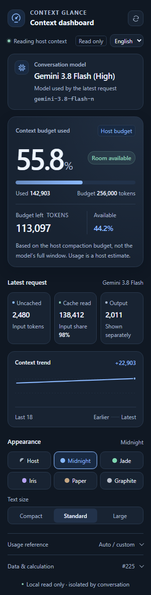
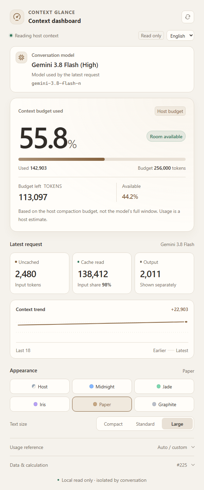
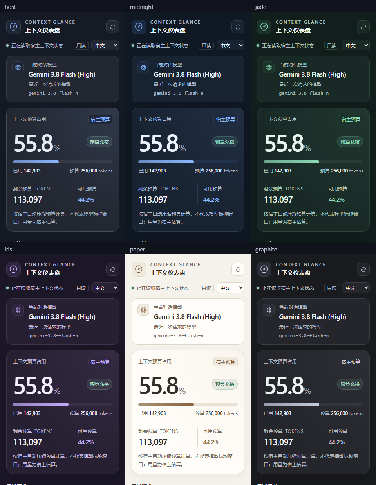

# Context Glance

[简体中文](README.md) | **English**

A read-only Antigravity Sidecar dashboard for context compaction budget, token usage, and the latest request's model. Supports multiple themes, font sizes, and Chinese / English interfaces, with no chat injection or model calls.

- **Budget at a glance:** usage percentage, remaining tokens, and budget status.
- **Request breakdown:** uncached input, cached input, and output shown separately.
- **Conversation model:** the latest request's model name, effort level when provided by the host, and model ID.
- **Six themes and three font sizes:** host theme, Midnight, Jade, Iris, Paper, and Graphite; compact, standard, and large text.
- **Chinese and English:** automatic initial language selection, a manual language control, and locally saved preferences.
- **Independent Sidecar:** a dedicated plugin directory and a host-assigned loopback port.



<details>
<summary>Paper theme and all six palettes</summary>




</details>

## Compatibility

Tested on **Windows with Antigravity App 2.31.2**. The installer supports Windows PowerShell 5.1 and PowerShell 7. The running plugin uses the host's bundled Node runtime and Sidecar SDK; no npm dependencies are required.

UI Extensions first appeared in Antigravity 2.22, but the internal read-only protocol has not been tested on every subsequent version. macOS and Linux desktop installations have not been verified. This is an Antigravity App Sidecar, not a VSIX extension or a Gemini API client.

## Installation

### From a ZIP or cloned repository

Open PowerShell in the project directory containing `Install.ps1` and `plugin/`:

```powershell
.\Install.ps1
```

If script execution is blocked, allow it for this installation process only:

```powershell
powershell.exe -NoProfile -ExecutionPolicy Bypass -File .\Install.ps1
```

The default target is `%USERPROFILE%\.gemini\config\plugins\context-glance`. Open **Context Glance / 上下文仪表盘** from the conversation header's **+ / Extensions** menu. Close and reopen the panel after an update; reopen the app if the host has not discovered the plugin yet.

The installer copies nine runtime files plus the two README files and MIT license, then verifies SHA256 hashes. It does not change other plugins or global host settings.

```powershell
.\Install.ps1 -CheckOnly
```

### With Antigravity CLI

From a downloaded source directory:

```powershell
agy plugin validate --strict ./plugin
agy plugin install ./plugin
```

Once the repository has been uploaded, its plugin subdirectory can be installed directly:

```powershell
agy plugin install https://github.com/Houleelen/Context-glance-For-Antigravity/tree/main/plugin
```

GitHub subdirectory installation is described in the [official CLI changelog](https://github.com/google-antigravity/antigravity-cli/blob/main/CHANGELOG.md). This project does not claim an official Marketplace listing.

## Language and appearance

The panel initially selects Chinese for a Chinese browser locale and English for other locales. Use the language selector to switch immediately; no extra model request is made. Your selection is saved locally, together with theme and font preferences. Model names and IDs retain the values supplied by the host.

## What the numbers mean

**The host's compaction budget is not the model's advertised context window.** In the verified setup, the host reports a budget of 256,000 tokens, while Gemini 3.8 Flash's documented input window is 1,048,576. The default percentage measures estimated usage against the host's current compaction budget.

A custom reference value only changes the displayed ratio. It does not expand the model's window, change the host's compaction threshold, or disable compaction.

The model card shows the model used by this conversation's **latest recorded request**. Selecting a different model without sending a new request may leave the previous model visible until the next request is recorded.

If native state is unavailable, the panel falls back to this conversation's local transcript. It uses the latest valid request's uncached input plus cached input, shows output separately, and never sums all turns. An unknown reference size is displayed as `--`.

## Privacy and resource usage

The plugin registers no Skills, Rules, Agents, MCP servers, or Hooks. It does not send chat messages, invoke a model, read other plugins' state, or modify the host database. Its HTTP service binds to loopback only, using a port allocated by the host.

The panel polls about every 1.5 seconds while visible. Polling stops when hidden, and the backend closes idle state subscriptions after about 12 seconds.

Native usage and model identity rely on internal read-only host interfaces. A host update or permission change may make those interfaces unavailable; the panel then falls back or displays an unknown state. It does not bypass permissions. Extra metadata fields returned by the host are discarded in memory.

## Development

Use Node.js 24. No npm install step is needed:

```powershell
node scripts/check-publish.mjs
node --test test/*.test.mjs
```

The host SDK integration test explicitly skips when the SDK is absent; a skip does not demonstrate desktop integration on that machine. The offline publishing check is not a substitute for the official `agy plugin validate --strict` command.

Optional real-browser checks require Node.js 24 and Windows Edge. They use mock data and an isolated browser profile:

```powershell
node test/visual-check.mjs
```

Set `CONTEXT_GLANCE_EDGE` if Edge is installed elsewhere. Generated data stays in `.verification/` and is excluded from Git and release archives. See the [contribution guide](CONTRIBUTING.md) and [publishing guide](docs/PUBLISHING.md) for additional details; these guides are currently in Chinese.

## License

Copyright (c) 2026 houleelen. Licensed under the [MIT License](LICENSE).

This is an independent third-party project and is not affiliated with Google.
