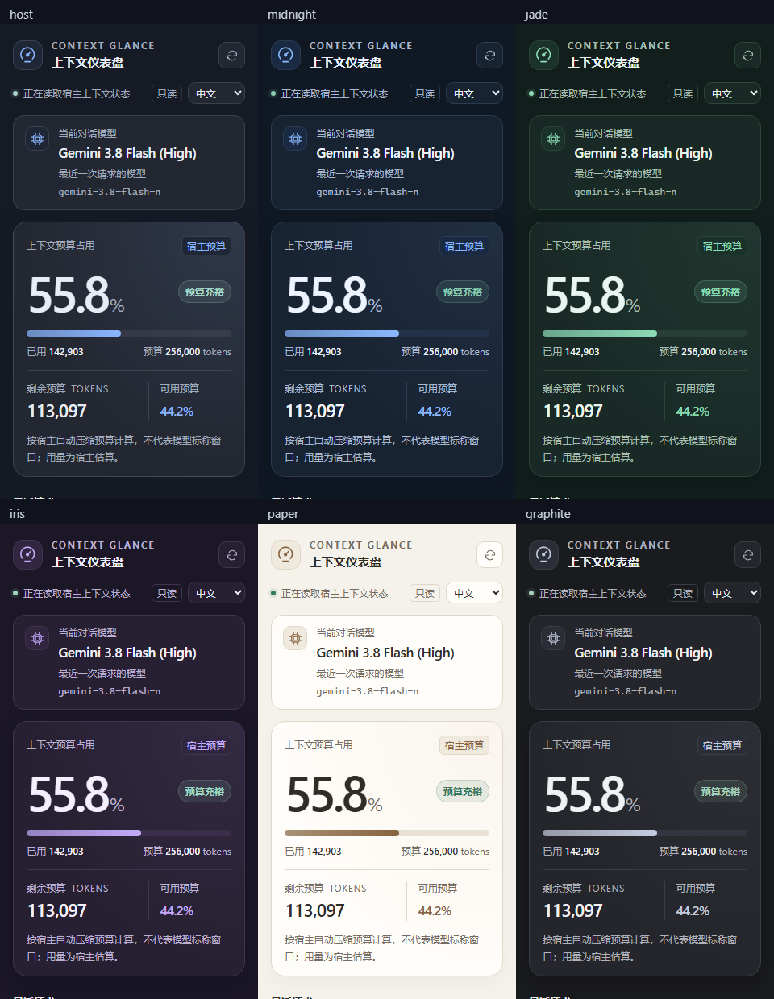
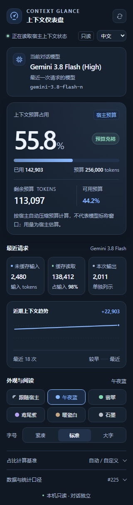
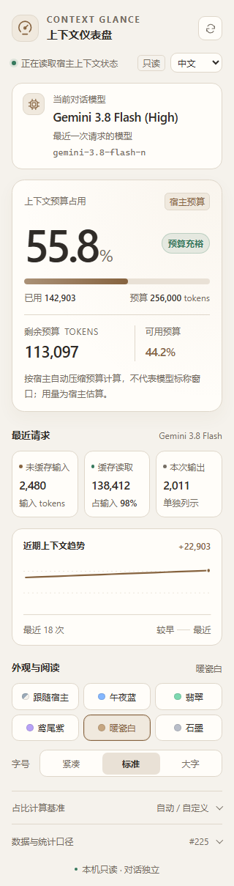

# Context Glance · 上下文仪表盘

**简体中文** | [English](README.en.md)

在 **Antigravity App** 的右侧辅助面板查看上下文压缩预算、剩余 Token、变化趋势与当前对话最近实际请求的模型。所有读取都在本机进行，不发起模型推理，不向对话添加内容。

- **一眼查看预算**：大号占比、剩余预算和容量状态。
- **请求明细**：未缓存输入、缓存读取、输出分别列示。
- **模型信息**：展示模型名称、思考档位（宿主名称包含时）与原始模型 ID。
- **六套配色 / 三档字号**：跟随宿主、午夜蓝、翡翠、鸢尾紫、暖瓷白、石墨；紧凑、标准、大字。
- **中英文界面**：首次跟随浏览器语言，也可手动选择；语言、配色和字号在面板本地保存。
- **独立运行**：独立插件目录与宿主分配的端口，可与其他上下文插件并存。



<details>
<summary>查看午夜蓝与暖瓷白完整截图</summary>




</details>

## 兼容性

已在 **Windows + Antigravity App 2.31.2** 验证。安装脚本支持 Windows PowerShell 5.1 / PowerShell 7；运行使用宿主内置 Node 和 Sidecar SDK，无需 npm 依赖。

UI Extensions 自宿主 2.22 起提供，但本插件的内部读取协议没有在所有版本测试。macOS / Linux 桌面尚未做实机验证。详见 [兼容性与数据说明](docs/COMPATIBILITY.md)。

## 安装

### 下载 ZIP 或克隆仓库后安装

进入包含 `Install.ps1` 与 `plugin/` 的项目目录，在 PowerShell 中运行：

```powershell
.\Install.ps1
```

执行策略阻止脚本时，可仅为这一次安装进程指定：

```powershell
powershell.exe -NoProfile -ExecutionPolicy Bypass -File .\Install.ps1
```

默认安装位置为 `%USERPROFILE%\.gemini\config\plugins\context-glance`。在 Antigravity 的会话标题 `+` / 扩展菜单打开 **上下文仪表盘**。更新后关闭并重新打开面板；宿主尚未发现插件时可重新打开应用。

安装器只复制十个运行文件及中英文 README、LICENSE，并核对 SHA256，不修改全局配置或其他插件。检查已安装文件：

```powershell
.\Install.ps1 -CheckOnly
```

### 使用 Antigravity CLI

对已下载的源码：

```powershell
agy plugin validate --strict ./plugin
agy plugin install ./plugin
```

仓库上传后，可从 GitHub 的插件子目录安装。下列链接是计划发布地址，若仓库名不同请替换：

```powershell
agy plugin install https://github.com/Houleelen/Context-glance-For-Antigravity/tree/main/plugin
```

GitHub 子目录安装由 [官方 CLI 更新记录](https://github.com/google-antigravity/antigravity-cli/blob/main/CHANGELOG.md) 说明。此项目尚不声称已在官方 Marketplace 收录。

## 如何理解数值

**宿主预算不等于模型标称总窗口。** 本机示例中，宿主返回 256,000 的自动压缩预算，而 Gemini 3.8 Flash 的官方输入窗口为 1,048,576。面板默认显示当前估算用量占宿主预算的比例，不将它误称为模型 1M 窗口的占比。

手动基准只影响显示比例，不能扩大模型窗口、改变压缩阈值或关闭自动压缩。模型卡取自该会话最近实际请求；仅切换模型而尚未发出新请求时，仍可能显示上一次请求的模型。

内部状态接口不可用时降级为当前会话的只读日志：使用最近请求的输入与缓存之和，输出单列，不累计各轮；缺少参考基准时显示 `--`。

## 隐私与资源

不注册 Skills、Rules、Agents、MCP 或 Hooks；不发消息、不调用模型、不读取其他插件状态。状态服务仅绑定本机回环地址。面板隐藏后停止轮询，后端约 12 秒空闲后回收订阅。

1.3.1 起每约 5 秒检查注入的宿主本机健康端点。连续连接失败后关闭本插件的订阅与 HTTP 服务并自行退出，降低 Windows 下宿主退出后遗留 Sidecar 的风险。该机制不结束其他插件或内置 Swarm；隐藏面板时宿主仍存活，插件进程继续由宿主管理。

当前用量和模型信息依赖宿主内部只读协议，未来版本可能改变；读取不可用时明确降级或显示未知，不绕过权限。接口字段与限制详见 [数据说明](docs/COMPATIBILITY.md)。

## 开发与验证

开发使用 Node.js 24，无需安装 npm 包：

```powershell
node scripts/check-publish.mjs
node --test test/*.test.mjs
```

功能检查包含日志统计、会话隔离、状态流、模型刷新及只读接口限制。官方 SDK 集成测试在 SDK 缺失时会明确跳过；这不代表该环境已完成实机验证。

可选视觉检查需要 Node.js 24 与 Windows Edge，使用模拟会话和独立浏览器目录：

```powershell
node test/visual-check.mjs
```

开发输出位于 `.verification/`，不进入 Git 或发布包。提交与打包步骤见 [参与开发](CONTRIBUTING.md)、[发布说明](docs/PUBLISHING.md)。

## 许可

作者：houleelen。本项目按 [MIT 许可证](LICENSE) 分发。变更记录见 [CHANGELOG](CHANGELOG.md)。

本项目为独立第三方工具，与 Google 无隶属关系。
